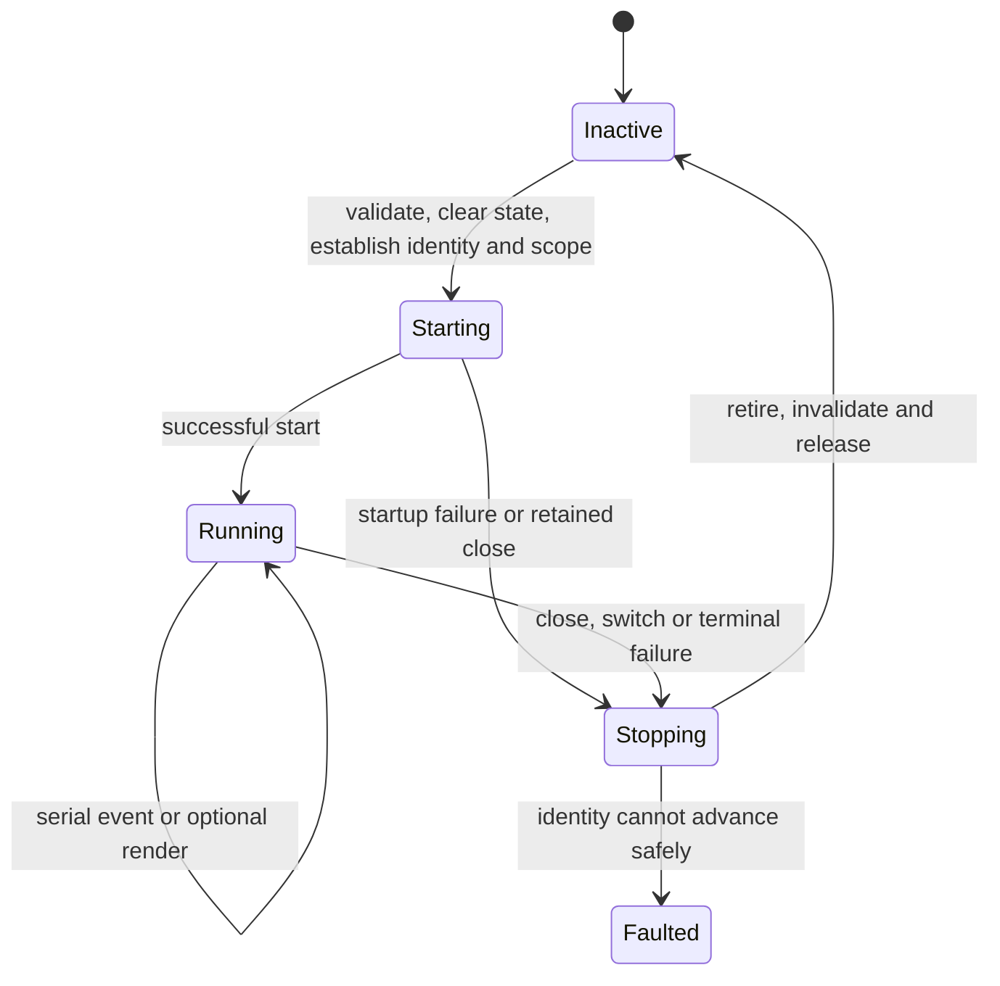
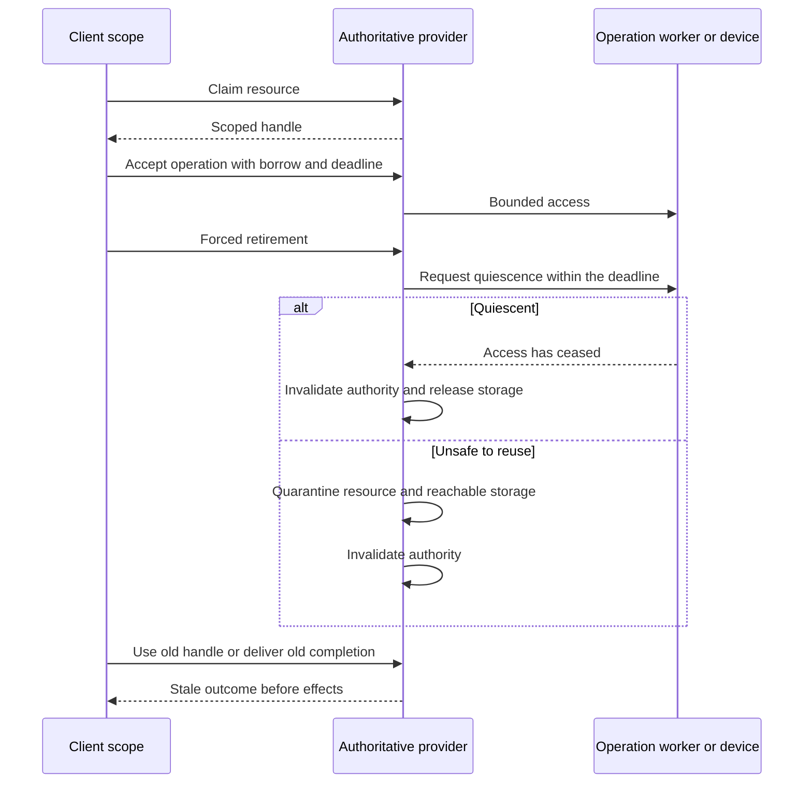
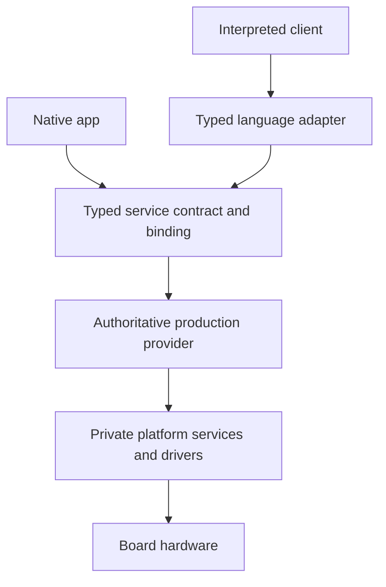

# Architecture viewpoints

These views describe the candidate architecture across implementations. The
[K210 mapping](../../implementation/K210_SPEC_MAPPING.md) relates its concrete
choices to these contracts.

## Execution and lifecycle

The audience includes runtime authors and app authors. The concerns are launch
eligibility, foreground admission, ordered dispatch, time bounds and unwind.
The state machine tracks one foreground slot. Persistent services and script
runs have independently managed scopes.

At the transition out of the running event surface, the runtime delivers a
single runtime-close event. If start was entered, stop runs once. Retirement
uses the same deadline throughout and preserves the first terminal failure.
Scheduled and observed callback times use the boot-local Time domain.
The relevant contracts are [composition](README.md#composition),
[lifecycle](README.md#lifecycle) and [time and errors](README.md#time-and-errors).

## Resource ownership and lifetime

The audience includes service authors and conformance reviewers. The concerns
are exclusive effects, bounded capacity, physical quiescence and old authority
after a scope closes. The sequence shows a forced retirement with outstanding
access. The owner arbitrates other requests using the service's documented
conflict granularity.

Scopes can retire independently. The runtime uses its own records to retire
scope resources. Authority, access and storage lifetime are checked under
[ownership](README.md#ownership), [lifecycle](README.md#lifecycle) and each
typed [service contract](SERVICES.md).

## Portability and binding

The audience includes platform integrators and app authors. The concerns are
service substitution, stable native and interpreted behavior, and the boundary
of implementation-specific knowledge. Arrows show the permitted direction of
typed calls and provider dependencies for a shared operation.

The binding fixes the declared provider selection. A language adapter
preserves units, outcome categories, scope and deadlines. A cross-context
implementation adds a bounded, synchronized handoff with explicit request
ownership. Shared Script routes corresponding native and interpreted calls to
the same authoritative provider. See [architecture](README.md#architecture),
[Shared Script](README.md#shared-script) and the [glossary](SPEC_GLOSSARY.md).

## Correspondence across views

The instance established in the execution view has the native scope in the
ownership view. Callback execution determines the lifetime of context and
render borrows. Work surviving a callback has its own operation identity and
must validate the intended instance before effects. Every path in the binding
view reaches the authority in the ownership view. Runtime, provider and
adapter use the same time domain for the deadline shown in both behavioral
views.
